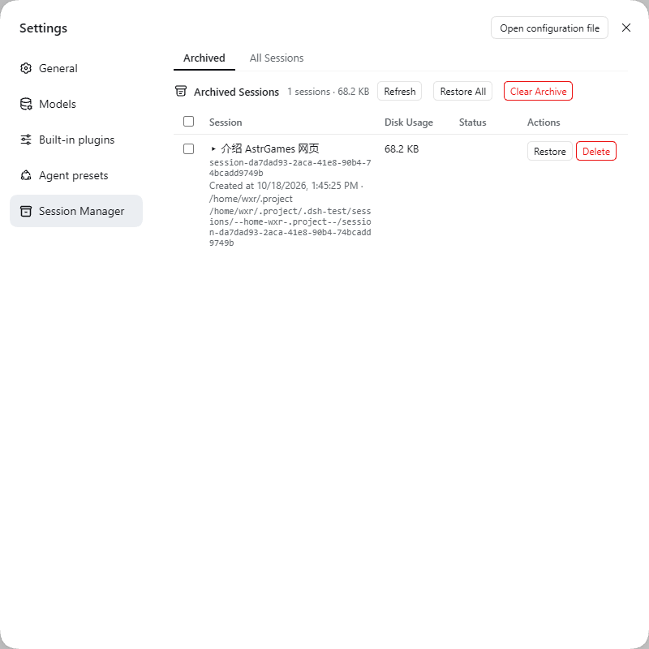
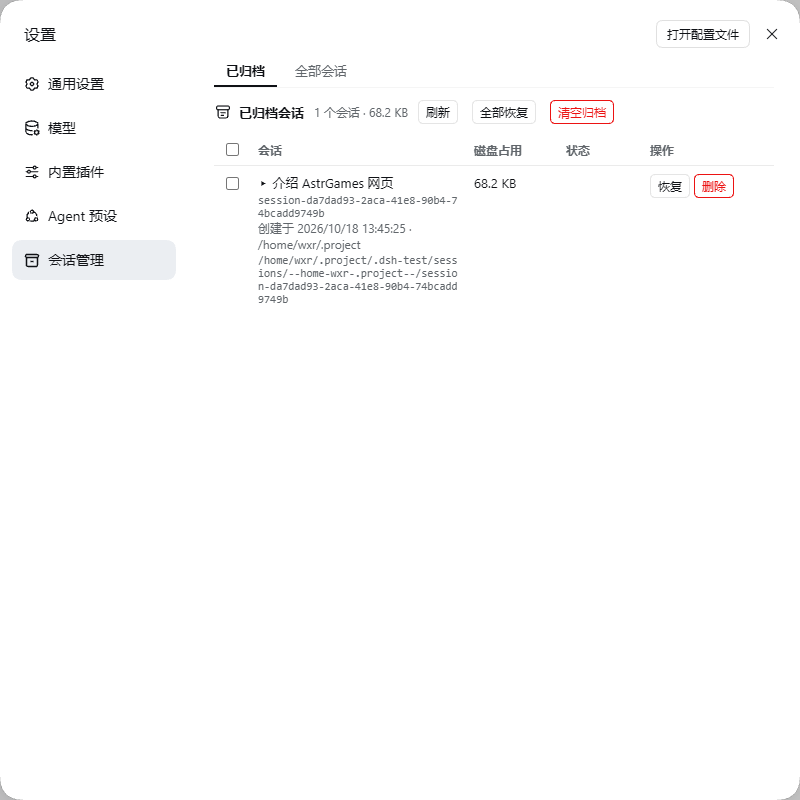

# dsh-session-manager

Session manager for [DeepSeek Harness](https://github.com/deepseek-ai/deepseek-harness).

[中文](README.zh.md) · [MIT License](LICENSE)

`dsh-session-manager` gives the Harness Web UI a full session-management surface: browse **all** sessions and the **archived** ones, restore (unarchive) archived sessions back to their original workspace, archive any session, delete sessions with a two-step confirmation, and preview conversation content — all from the Settings panel, with **zero modification to official packages**. Its UI follows the Harness language setting (English / 中文) and it ships a dedicated icon.

## What it solves

Stock DSH archives sessions one-way: the sidebar's Archive action hides a session from every view (workspace groups, ungrouped, search, flat list), and there is no view or API to bring it back — archived sessions are effectively lost until you hand-edit `~/.dsh/storages/workspace.json`. This plugin makes archiving a reversible, manageable state and adds an overview of every session on disk:

```
right-click a session -> Archive (stock DSH)
  -> the session vanishes from the sidebar (nowhere to see it again)
  -> this plugin: Settings -> Session Manager -> archived tab
       preview its content, Restore it (back to its original workspace
       position), or Delete it from disk (two-step confirmation)
  -> the all-sessions tab lists every persisted session (grouped by
     workspace, ungrouped ones included) so nothing is ever lost sight of
```

### 0.2.0: the “deleted session comes back in the sidebar” fix

Current DSH returns **listing snapshots** (`{ header, revision, ... }`) from `sessionPersistence.list()`, not bare headers. The previous release read `snapshot.id` (always `undefined`), so it could not find the stored session during delete: it pruned the archive/workspace bookkeeping and reported success **without removing the files**. Removing the archive entry made the still-existing session visible in the sidebar again — exactly the reported ghost.

0.2.0 normalizes both the current snapshot shape and the legacy header shape, resolves the real JSONL session directory, and only prunes bookkeeping **after** the directory is removed (or proven absent). If a listed session's artifact cannot be located, delete refuses with an error and leaves every bookkeeping record untouched.

### 0.2.1: the “duplicate prefix route” activation failure

The `/dsh-sm` prefix was registered outside the plugin fiber: `apply()` called `ctx.webServer.register()` directly and never handed the disposer to `ctx.effect()`. Unloading therefore left the prefix in the web server table, and the next load — HMR reload, disable/enable, or a reinstall through the plugin manager — failed activation with `webserver: duplicate prefix route "/dsh-sm"`, while the stale route kept answering requests. 0.2.1 registers the route inside `ctx.effect()`, so the disposer follows the fiber and reloads are clean. The leaked route only exists in the already-running process, so restart `dsh web` once after updating.

## Features

- **Restore archived sessions**: an archived session keeps its workspace accounting slot, so unarchiving puts it back exactly where it was — single, batch, or all at once.
- **Safe delete with two-step confirmation**: the Delete button arms first and needs a second click within 5 seconds. The server removes the session directory, then prunes the archive set, pin set, and workspace slot. A listed session whose directory cannot be resolved is refused instead of leaving orphan files behind.
- **Live-session guard**: running agents are rejected. An open unarchived session is also refused (it could recreate its log); an archived live session is flushed through its open writer and evicted before deletion.
- **Delete all**: clears every deletable session (archived, ungrouped, and workspace-attached alike) in one confirmed action, skipping sessions that are currently running or open, and reports per-session success / failure / skip.
- **All-sessions overview**: every session known to the persistence layer — title, id, creation time, owning workspace (or *ungrouped*), status badges (archived / live / running) — with archive and delete actions.
- **Content preview**: click a session title to expand the first 100 user / assistant / tool messages without opening the conversation.
- **Disk footprint**: per-session size and the full on-disk path help you find what is eating space.
- **Follows the Harness language**: the Settings entry and the whole page are localized through `ctx.locale`, so switching Settings → General → Language (English / 中文) updates the plugin immediately; Chinese users get Chinese dates and all labels.
- **Dedicated icon**: a custom archive/session mark ships as `assets/icon.svg` for the Plugins inventory, and the Settings navigation reuses DSH's archive glyph instead of the generic gear.
- **Zero core modification**: a pure bundle plugin (`dsh.bundle` patch layer); every operation goes through official services (`workspaceRegistry`, `sessionQuery`, `sessionPersistence`, `sessions`, `agents`, `dshHomePath`) — no official package is patched or overridden.
- **Loopback-only API**: the `/dsh-sm/*` routes reject non-loopback hosts and cross-origin requests (Host + Origin / Sec-Fetch-Site fence).

## Installation

```sh
# one line, from a git source
dsh plugin --profile web add github:wuxiangru915/dsh-session-manager

# restart the web server, then hard-refresh the page
```

Local development:

```sh
dsh plugin --profile web add /path/to/dsh-session-manager

# restart the web server, then hard-refresh the page
```

The repository ships plain-JS `lib/` artifacts with no build step, so git-source installs work without any build tooling on the user's machine.

## Usage

### Web UI



Open **Settings → Session Manager**:

- **Archived** tab (default): every archived session with title, id, creation time, cwd, disk size and the full on-disk path; status badges for *running* and *missing files*. Buttons: **Restore** (single / batch / all), **Clear archive** (delete all archived, two-step), row-level **Delete** (two-step).
- **All sessions** tab: every persisted session grouped by workspace (ungrouped sessions show a `—`), status badges for *archived / live / running*. Actions: **Archive**, **Delete**, and **Delete all** (two-step; skips running/open sessions).
- Click any session title to preview its content inline (user / assistant / tool messages, first 100).
- Switch **Settings → General → Language** to 中文 or English; the plugin re-registers its labels and re-renders immediately (no page refresh).



## Architecture

```
lib/
├── index.js   Host half: cordis plugin (injects webServer) exposing POST /dsh-sm/* routes
└── client.js  Browser half: __ModuleLoader__ bundle registering the Settings section
cordis.patch.yml   dsh.bundle patch layer — one insert row drives both halves
assets/icon.svg    Dedicated plugin icon (manifest-relative, ≤256 KiB)
locale/en.json     Plugin-inventory metadata (English)
locale/zh.json     Plugin-inventory metadata (Chinese)
```

```
browser (Settings page) --POST /dsh-sm/*--> host handlers
   archived/list · archived/unarchive · sessions/list · sessions/archive
   · sessions/delete · sessions/detail
   sessionQuery (list + titles + content) + sessionPersistence (headers/legacy locate)
   + workspaceRegistry (archive/pin/workspace accounting) + sessions (evict/flush)
   + dshHomePath + node:fs (locate, size, delete the JSONL session directory)
   + agents (running guard)
```

Host routes:

| Route | Payload | Returns |
|---|---|---|
| `POST /dsh-sm/archived/list` | `{}` | `{ items, totalBytes }` |
| `POST /dsh-sm/archived/unarchive` | `{ sessionId }` | `{ ok, changed, archivedSessionIds }` |
| `POST /dsh-sm/sessions/list` | `{}` | `{ items }` |
| `POST /dsh-sm/sessions/archive` | `{ sessionId }` | `{ ok, archivedSessionIds }` |
| `POST /dsh-sm/sessions/delete` | `{ sessionId }` | `{ ok, deleted, sessionId, path?, sizeBytes?, reason? }` |
| `POST /dsh-sm/sessions/detail` | `{ sessionId }` | `{ id, createdAt, cwd, totalEvents, messageCount, truncated, messages }` |

Unarchive/delete use the registry's public `unarchiveSession` / `unpinSession` paths (with a durable-state fallback for older registries), so the registry's in-memory state, the on-disk `global.archivedSessionIds`, and the workspace feed stay consistent; the client refreshes the workspace/session stores afterwards so the sidebar updates immediately.

Session directories are resolved through `ctx.dshHomePath("sessions")` as `<home>/sessions/<project>/<sessionId>/`; an older persistence `locate(header)` implementation is preferred when present.

## Testing

```sh
npm test                # 19 host checks + 3 client checks
node test/smoke.mjs     # host only: stub services + a real temp Harness home
node test/client.mjs    # client only: locale dictionaries + section registration
```

The host smoke test drives `apply(ctx)` with stub services and creates actual session directories in a temporary Harness home. It covers route wiring, the loopback/origin fence, archive-set read/write, the current snapshot `list()` shape, the legacy header shape, real on-disk deletion, live-session flush/refusal, orphan-directory cleanup, the “cannot locate the artifact ⇒ refuse to prune” guard, path-traversal rejection and detail extraction. The client test loads `lib/client.js` in a vm and verifies that both locale dictionaries are complete and that the Settings entry uses the `archived-sessions` id and re-reads the active locale.

End-to-end verification was performed against a real second profile: archive → archived list → two-step delete → sidebar/list no longer contain the session, plus a browser walkthrough of the English ↔ 中文 switch and the icon in the Plugins inventory.

## Compatibility

- DSH 0.2.x (`sessionPersistence.list()` snapshots).
- DSH versions whose `sessionPersistence.list()` returns bare headers (legacy shape) still work.
- The JSONL backend is the shipped default; backends that expose `locate()` are also supported. A backend with neither `locate()` nor the shipped JSONL tree makes delete fail closed rather than risk orphan files.

## Roadmap

- [x] Archived-session list / restore / delete (two-step)
- [x] All-sessions overview + archive any session
- [x] Delete all (skips running/open) with per-item results
- [x] Inline content preview
- [x] Follows the Harness language setting
- [x] Dedicated plugin icon
- [x] Safe deletion of the real artifact (0.2.0)
- [ ] Recycle bin (soft delete with undo window)
- [ ] Sidebar entry in addition to the Settings page
- [ ] npm release
